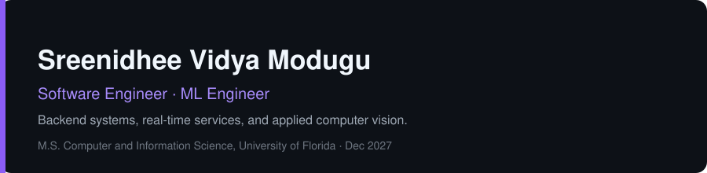

 
    

👋 Hi, I'm Sreenidhee

I build backend systems and ML pipelines end to end: Java services in production, Go backends with Kafka and Redis, and PyTorch computer-vision models. I spent two years in production engineering at Accenture, did an ML internship at DRDO, and I'm now doing my M.S. in CIS at the University of Florida.

go
type Engineer struct {
    Name      string
    Roles     []string
    Education string
    Builds    []string
    Exploring []string
    OpenTo    []string
}

var me = Engineer{
    Name:      "Sreenidhee Vidya Modugu",
    Roles:     []string{"Software Engineer", "ML Engineer"},
    Education: "M.S. CIS @ University of Florida",
    Builds:    []string{"event-driven backends", "real-time services", "computer vision models"},
    Exploring: []string{"distributed systems", "Erlang/OTP actor model"},
    OpenTo:    []string{"SDE", "Backend", "ML Engineering"},
}
💼 Experience

🏢 Software Engineer · Accenture

Owned features for production Guidewire policy and billing apps in Java and Gosu, from design through CI/CD
Built REST integration workflows and a release-health metrics dashboard; served on the on-call rotation

🛰️ Software Engineer Intern · DRDO

Built a YOLOv8 detection pipeline in PyTorch over ~20k aircraft images: ~25% accuracy gain over baseline
Rewrote hot paths in C++ for a ~20% speedup
🧰 Tech Stack
<table> <tr> <td><b>Languages</b></td> <td>  </td> </tr> <tr> <td><b>Backend & Data</b></td> <td></td> </tr> <tr> <td><b>ML & AI</b></td> <td>  </td> </tr> <tr> <td><b>Cloud & DevOps</b></td> <td></td> </tr> </table>
🔨 Things I've Built
⚙️ Backend & Distributed Systems
Project	What I built	Stack
feed-engine	Reddit-style feed backend. Kafka fans post events out to per-user Redis sorted-set feeds, so a 10k-follower post never blocks the API. Idempotent at-least-once consumers make every event safe to replay.	Go Kafka Redis PostgreSQL Docker
Real-Time-Chat-Service	One-to-one chat with a dedicated WebSocket server, a broadcaster goroutine, and Redis-backed history and contact lists ranked by last activity.	Go WebSockets Redis React
Pastry-in-Erlang	Pastry peer-to-peer overlay network built on the actor model, with a key-value store on top.	Erlang/OTP P2P
Gossip-Simulator	Gossip and push-sum protocols across full, line, 2D, and imperfect-2D topologies.	Erlang/OTP
Bitcoin-Mining	Boss/worker SHA-256 miner that spreads the search across CPU cores and remote machines.	Erlang/OTP
🧠 Machine Learning & AI
Project	What I built	Result
Iris-Recognition	Biometric iris recognition: 64-filter Gabor bank features into a Deep Belief Network (greedy RBM pre-training, then fine-tuning).	86% accuracy · 87% recall
PEGASUS-Summarizer	Fine-tuned pegasus-large on SAMSum for abstractive dialogue summarization.	ROUGE-1 52.4 · BERTScore 89.2
Test-Case-Generator	AI agents that turn user stories into positive, negative, and edge-case test scenarios.	Faster QA planning
📈 On GitHub

   
  
❯ always building something · <a href="https://www.linkedin.com/in/sreenidhee-vidya-modugu-231399221">let's talk</a>

